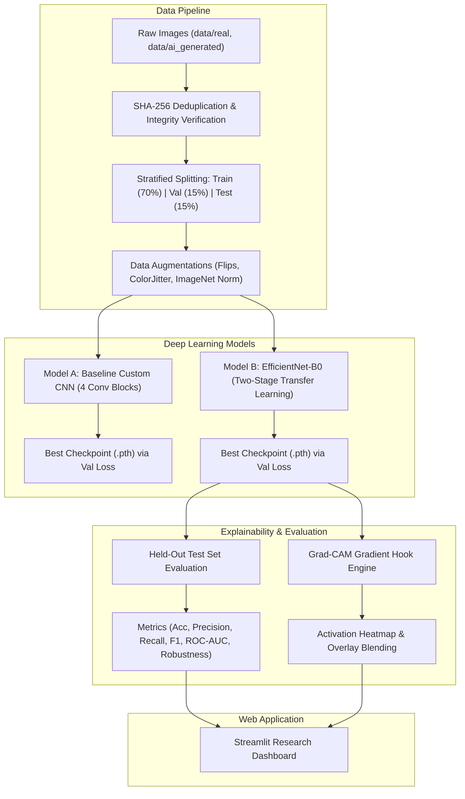

# AI-Generated Image Detection Using Deep Learning and Explainable AI

[](https://www.python.org/)
[](https://pytorch.org/)
[](https://streamlit.io/)
[](LICENSE)
[]()

> A robust, scientifically grounded final-year B.Tech CSE (Data Science and Machine Learning) project designed to distinguish between authentic camera photographs and AI-synthesized imagery (Diffusion models, GANs) using **EfficientNet-B0 transfer learning**, a **Custom CNN baseline**, and **Grad-CAM (Explainable AI)**.

---

## 📌 Table of Contents
1. [Project Overview](#-project-overview)
2. [Key Features](#-key-features)
3. [System Architecture](#-system-architecture)
4. [Project Structure](#-project-structure)
5. [Installation & Setup](#-installation--setup)
6. [Dataset Preparation & Leakage Prevention](#-dataset-preparation--leakage-prevention)
7. [Model Training Workflows](#-model-training-workflows)
8. [Evaluation & Robustness Experiments](#-evaluation--robustness-experiments)
9. [Running the Streamlit Web Application](#-running-the-streamlit-web-application)
10. [Explainable AI: Grad-CAM Methodology](#-explainable-ai-grad-cam-methodology)
11. [Model Limitations & Ethical Safeguards](#-model-limitations--ethical-safeguards)
12. [Troubleshooting Guide](#-troubleshooting-guide)
13. [Academic Dossier & Viva Voce Guide](#-academic-dossier--viva-voce-guide)

---

## 🔍 Project Overview

With the exponential advancement of Latent Diffusion Models (Stable Diffusion, Midjourney, DALL-E 3) and Generative Adversarial Networks (StyleGAN3, ProGAN), synthetic imagery has reached high perceptual photorealism. Human observers can no longer reliably distinguish algorithmically generated visual media from real optical photography.

This project delivers:
- **Two Deep Learning Architectures**:
  - **EfficientNet-B0**: Two-stage transfer learning with inverted residual blocks.
  - **Custom CNN**: 4-block baseline convolutional network trained from scratch.
- **Explainable AI (Grad-CAM)**: Exposes internal convolutional gradient activations to visually isolate spatial synthetic artifacts.
- **Multi-Modal Forensic Suite**:
  - **2D Fast Fourier Transform (FFT)**: Log magnitude spectrum detecting deconvolution checkerboard and azimuthal frequency spikes.
  - **Error Level Analysis (ELA)**: 90% JPEG compression delta matrix highlighting local manipulation disparities.
  - **Metadata & AI Prompt Inspector**: Parses PNG/WebP chunks for embedded generative prompts and camera EXIF.
- **"Human vs. AI" Turing Test Challenge**: Interactive viva quiz game comparing human eye perception accuracy against EfficientNet-B0.
- **One-Click Forensic Audit Certificate**: Downloadable formal audit reports with SHA-256 evidence hashing.
- **Rigorous Data Engineering**: Enforces cryptographic SHA-256 deduplication to prevent data leakage between training and testing subsets.
- **Robustness Benchmarking**: Evaluates accuracy under social media perturbations (JPEG compression $Q=50$, Gaussian defocus blur, and spatial downscaling).
- **Interactive UI**: A production-ready Streamlit research dashboard designed with a dark navy aesthetic for technical demonstrations and viva defense.

---

## ✨ Key Features

- **Genuine Deep Learning Inference**: Uses real trained PyTorch weights (`.pth`), never mock predictions or hardcoded outputs.
- **Automated Demo Mode**: Includes an automated sample dataset generator so examiners and evaluators can verify the full pipeline end-to-end immediately without downloading 50GB archives.
- **Explainability First**: True PyTorch hook-based Grad-CAM implementation targeting final convolutional layers.
- **Calibrated Probabilities**: Outputs authentic softmax distribution scores and explicit explanations that predictions indicate likelihood rather than cryptographic proof.
- **Security-First Architecture**: Strictly validates image headers, enforces 15MB file caps, executes in-memory inference without saving user files, and handles corrupted images gracefully.

---

## 🏛 System Architecture



---

## 📂 Project Structure

```
AI-Generated Image Detection/
├── app.py                      # Main Streamlit Dashboard (Home, system status, navigation)
├── config.py                   # Central hyperparameters, paths, and hardware settings
├── requirements.txt            # Project dependencies
├── README.md                   # Complete documentation
├── models/
│   ├── __init__.py
│   ├── cnn_model.py            # Model A: Baseline Custom CNN architecture
│   ├── efficientnet_model.py   # Model B: EfficientNet-B0 transfer learning architecture
│   └── inference.py            # Unified inference engine with Grad-CAM integration
├── training/
│   ├── __init__.py
│   ├── prepare_data.py         # Data verification, SHA-256 deduplication, splits & demo data
│   ├── train_cnn.py            # Baseline CNN training script
│   ├── train_efficientnet.py   # EfficientNet-B0 two-stage transfer learning pipeline
│   └── evaluate.py             # Held-out test evaluation, ROC-AUC, and robustness testing
├── explainability/
│   ├── __init__.py
│   └── gradcam.py              # True PyTorch hook-based Grad-CAM implementation
├── utils/
│   ├── __init__.py
│   ├── preprocessing.py        # Safe image loading, transformations, and perturbations
│   └── visualization.py        # Publication-quality plotting (Loss/Acc, CM, ROC, Robustness)
├── pages/
│   ├── 1_Image_Detection.py    # Streamlit Page 1: Live detection & Grad-CAM visualizer
│   ├── 2_Model_Evaluation.py   # Streamlit Page 2: Benchmark metrics, confusion matrix, ROC
│   └── 3_About_Project.py      # Streamlit Page 3: Problem statement, architecture & 20 Viva Q&A
├── data/
│   ├── README.md               # Dataset guide (GenImage, CIFAKE)
│   ├── real/                   # Raw authentic photographs
│   ├── ai_generated/           # Raw AI-generated images
│   └── splits/                 # Train, val, and test splits + dataset_manifest.json
├── artifacts/
│   └── README.md               # Checkpoint directory (.pth weights & training histories)
├── reports/
│   └── README.md               # Generated metric JSON and high-DPI evaluation plots
└── docs/
    └── FINAL_YEAR_PROJECT_REPORT.md # Comprehensive final-year academic dossier
```

---

## 💻 Installation & Setup

### 1. Prerequisites
- Python 3.10 or 3.11 installed.
- Git (optional, for version control).

### 2. Create Virtual Environment
```bash
# Windows (PowerShell)
py -3.11 -m venv .venv
.\.venv\Scripts\Activate.ps1

# Linux / macOS
python3.11 -m venv .venv
source .venv/bin/activate
```

### 3. Install Dependencies
```bash
pip install -r requirements.txt
```

---

## 📊 Dataset Preparation & Leakage Prevention

1. Place your raw images in:
   - `data/real/` (authentic camera photographs)
   - `data/ai_generated/` (synthetic images from Midjourney, Stable Diffusion, DALL-E, etc.)
2. Run data preparation:
   ```bash
   python training/prepare_data.py
   ```
   *Note: If `data/real/` and `data/ai_generated/` are empty, `prepare_data.py` automatically synthesizes structured photographic and generative starter samples so you can test the entire workflow immediately without downloading gigabytes of data.*

3. Features enforced:
   - **Zero Data Leakage**: Computes SHA-256 hashes of every file; duplicates are permanently eliminated.
   - **Stratification**: 70% Train, 15% Validation, 15% Held-Out Test.

---

## 🏋️ Model Training Workflows

### Train Baseline Custom CNN (Model A)
```bash
python training/train_cnn.py
```
- Trains a 4-block CNN from scratch with AdamW optimizer and Cosine Annealing learning rate.
- Checkpoints best weights to `artifacts/best_custom_cnn.pth`.

### Train EfficientNet-B0 (Model B - Transfer Learning)
```bash
python training/train_efficientnet.py
```
- **Stage 1 (Head Warmup)**: Backbone frozen; trains custom 2-class classification head at $\eta = 10^{-3}$.
- **Stage 2 (Fine-Tuning)**: Unfreezes top inverted residual blocks; trains at $\eta = 10^{-4}$ with Cosine Annealing.
- Checkpoints best weights to `artifacts/best_efficientnet_b0.pth`.

---

## 📈 Evaluation & Robustness Experiments

Execute comprehensive evaluation across both models strictly on the held-out test split:

```bash
python training/evaluate.py
```

### Deliverables Generated:
- **`reports/evaluation_metrics.json`**: Accurate Accuracy, Precision, Recall, F1, ROC-AUC, and robustness degradation metrics.
- **Visual Plots**:
  - Training and validation loss/accuracy curves.
  - Normalized confusion matrix heatmaps.
  - ROC curves with AUC scores.
  - Model comparison bar chart.
  - Robustness degradation chart (Clean vs JPEG $Q=50$ vs Blur vs Downscaling).

---

## 🚀 Running the Streamlit Web Application

Launch the research dashboard:

```bash
streamlit run app.py
```

Open your browser at `http://localhost:8501`.

### Web Features:
1. **Home Dashboard (`app.py`)**: System overview, live model checkpoint status badges, project highlights.
2. **Live Detection (`pages/1_Image_Detection.py`)**: Drag-and-drop image upload, real-time inference, Softmax probability distribution, Grad-CAM heatmap overlay, and session history.
3. **Model Evaluation (`pages/2_Model_Evaluation.py`)**: Interactive benchmark cards, confusion matrices, ROC curves, training dynamics, and robustness tests.
4. **About Project (`pages/3_About_Project.py`)**: Problem statement, methodology, Grad-CAM math, and **20 detailed Viva Voce questions and answers**.

---

## 🔬 Explainable AI: Grad-CAM Methodology

Grad-CAM (*Gradient-weighted Class Activation Mapping*, Selvaraju et al., 2017) computes neuron importance weights $\alpha_k^c$ via global average pooling of gradients:

$$\alpha_k^c = \frac{1}{Z} \sum_{i=1}^U \sum_{j=1}^V \frac{\partial y^c}{\partial A_{i,j}^k}$$

$$L_{\text{Grad-CAM}}^c = \text{ReLU}\left( \sum_k \alpha_k^c A^k \right)$$

- Target layer for EfficientNet-B0: `backbone.features[-1]` (1280-channel representation).
- Target layer for Custom CNN: `block4[0]` (final Conv2D layer).
- The resulting activation map isolates spatial regions driving the model's decision (e.g., unnatural skin smoothness, frequency-domain grid artifacts, texture boundaries).

---

## ⚠️ Model Limitations & Ethical Safeguards

1. **Not a Cryptographic Guarantee**: Softmax probabilities indicate pattern correlation with training distributions, not mathematical certainty.
2. **Unseen Generator Generalization**: Future diffusion architectures with fundamentally novel latent spaces may require retraining.
3. **Severe Compression Degradation**: Heavy JPEG re-compression ($Q < 30$) discards high-frequency details, challenging spatial classifiers.
4. **Privacy Safeguards**: Images are processed strictly in volatile memory and are never persisted to disk.

---

## 🛠 Troubleshooting Guide

| Issue | Cause | Solution |
| :--- | :--- | :--- |
| `FileNotFoundError: best_efficientnet_b0.pth` | Model weights have not been trained yet. | Run `python training/train_efficientnet.py` before running inference. |
| `ModuleNotFoundError: No module named 'torch'` | Virtual environment not activated. | Run `.\.venv\Scripts\Activate.ps1` (or activate your venv). |
| Out of Memory (OOM) on CPU/GPU | Batch size is too large for system RAM. | Reduce `DEFAULT_BATCH_SIZE = 8` in `config.py`. |
| Port 8501 already in use | Previous Streamlit instance still running. | Run `streamlit run app.py --server.port 8502`. |

---

## 🎓 Academic Dossier & Viva Voce Guide

For external viva presentation, literature review tables, data-flow diagrams, and complete model answers to 20 viva questions, refer to:
- [`docs/FINAL_YEAR_PROJECT_REPORT.md`](docs/FINAL_YEAR_PROJECT_REPORT.md)
- In-app tab: **Page 3 (About Project & Viva Guide)** inside the Streamlit web dashboard.

---

*Developed for Final-Year B.Tech Computer Science & Engineering (Data Science & Machine Learning).*

