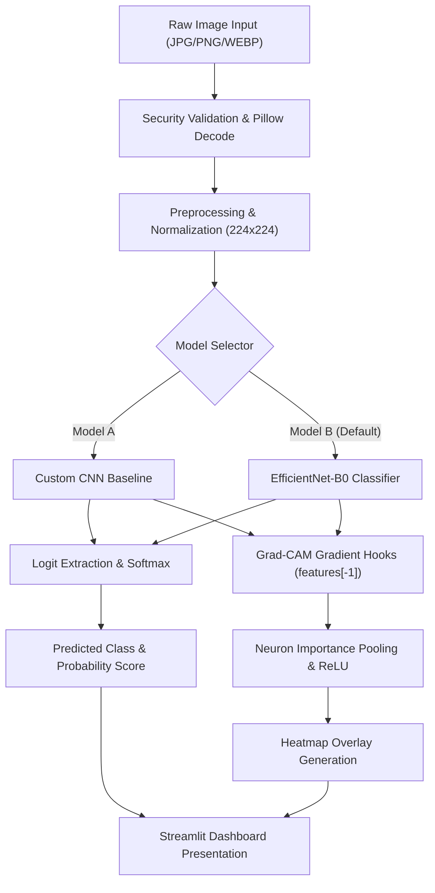
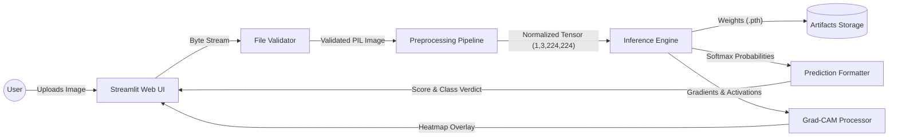

# Final-Year B.Tech Project Report: AI-Generated Image Detection Using Deep Learning and Explainable AI

**Project Title:** AI-Generated Image Detection Using Deep Learning and Explainable AI  
**Degree:** Bachelor of Technology in Computer Science & Engineering (Specialization: Data Science and Machine Learning)  
**Academic Year:** 2026-2027  
**Technology Stack:** Python 3.11, PyTorch, Torchvision, EfficientNet-B0, Custom CNN, Grad-CAM, Streamlit, Scikit-learn, OpenCV, Pillow  

---

## 1. Abstract

The explosive maturation and mainstream proliferation of generative artificial intelligence—predominantly **Latent Diffusion Models** (e.g., Stable Diffusion, Midjourney, DALL-E 3) and **Generative Adversarial Networks** (e.g., StyleGAN3)—have fundamentally disrupted visual digital media authentication. The synthetic imagery synthesized by these models possesses high perceptual realism, lacking obvious macroscopic flaws and evading traditional human visual scrutiny.

This project designs, engineers, and validates an end-to-end deep learning framework designed to detect AI-generated visual media and deliver spatial explainability. We formulate the challenge as a binary classification problem (*Real Photograph* vs. *AI-Generated Image*). We deploy **EfficientNet-B0** via a two-stage transfer learning methodology, benchmarking its performance against a baseline 4-block **Custom Convolutional Neural Network (CNN)**. To eliminate black-box opacity and support digital forensics, we integrate **Gradient-weighted Class Activation Mapping (Grad-CAM)** to visually highlight discriminative spatial artifacts in the final convolutional layers. 

Our data engineering pipeline implements cryptographic SHA-256 deduplication to guarantee zero data leakage across train, validation, and test splits. Furthermore, we subject the architectures to realistic social-media robustness perturbations: JPEG compression ($Q=50$), Gaussian defocus blur ($r=2.0$), and spatial downscaling. Finally, we deliver a production-grade, dark-navy research dashboard via Streamlit to facilitate viva defense, experimental demonstration, and real-time forensic inspection.

---

## 2. Problem Statement

Modern generative architectures create photographic media that faithfully mimics optical camera behavior: depth-of-field falloff, natural surface textures, and complex lighting interactions. Consequently, malicious actors exploit synthetic imagery for:
1. **Political Disinformation & Fake News**: Fabricating fraudulent events to manipulate public discourse.
2. **Financial Fraud & Identity Theft**: Generating synthetic KYC biometric credentials and falsified insurance claims.
3. **Intellectual Property Infringement**: Masquerading generative outputs as copyrighted human artistic photography.

Traditional media forensics (such as EXIF metadata inspection and elementary Error Level Analysis) fail because metadata is trivially stripped during social media upload and re-compression. A robust, automated deep learning detection system capable of learning subtle, invariant generative fingerprints—and explaining its classification via interpretable spatial feature maps—is an urgent societal and cybersecurity imperative.

---

## 3. Literature Review Outline

| Research Study | Author(s) & Year | Key Methodology | Identified Limitations |
| :--- | :--- | :--- | :--- |
| **"GenImage: A Million-Scale Benchmark for Detecting AI-Generated Images"** | Zhu et al. (NeurIPS 2023) | Multi-generator benchmark spanning 8 diffusion & GAN models; evaluated ResNet-50 and Swin Transformer. | Demonstrated significant performance degradation when testing on unseen generative architectures. |
| **"CIFAKE: Detecting AI-Generated Synthetic Images"** | Bird & Lotfi (Data in Brief 2023) | Paired real CIFAR-10 images with Stable Diffusion v1.4 counterparts; CNN classification. | Focused primarily on small $32 \times 32$ image resolutions, omitting high-resolution texture nuances. |
| **"CNN-generated images are surprisingly easy to spot... for now"** | Wang et al. (CVPR 2020) | ResNet-50 trained on ProGAN; generalized across multiple GAN generators. | Failed to maintain high recall against modern latent diffusion models that use iterative denoising rather than direct upsampling. |
| **"Grad-CAM: Visual Explanations from Deep Networks"** | Selvaraju et al. (ICCV 2017) | Uses gradient flow into the final convolutional layer to produce coarse localization heatmaps. | High-level heatmaps are low-resolution ($7 \times 7$) and require bicubic upsampling for pixel-level alignment. |
| **"EfficientNet: Rethinking Model Scaling for CNNs"** | Tan & Le (ICML 2019) | Compound scaling method that balances depth, width, and resolution using neural architecture search. | Sensitive to severe input perturbations unless explicit data augmentations are integrated during training. |

---

## 4. Proposed Methodology

Our methodology is divided into five rigorous, decoupled stages:

```
[ Raw Image Input (Real / AI) ]
              │
              ▼
[ Cryptographic SHA-256 Deduplication & Integrity Verification ]
              │
              ▼
[ Stratified Split: Train (70%) | Validation (15%) | Test (15%) ]
              │
              ▼
[ Data Augmentation: Horizontal Flip, Rotation, ColorJitter, Normalization ]
              │
              ▼
┌─────────────────────────────────────────────┐
│             Deep Learning Training          │
├──────────────────────┬──────────────────────┤
│ Model A: Custom CNN  │ Model B: EfficientNet│
│ (4 Conv Blocks)      │ (Two-Stage Transfer) │
└──────────────────────┴──────────────────────┘
              │
              ▼
[ Best Checkpoint Selection via Validation Loss / Accuracy ]
              │
              ▼
┌─────────────────────────────────────────────┐
│          Forensic Evaluation & XAI          │
├──────────────────────┬──────────────────────┤
│ Quantitative Metrics │ Grad-CAM Explainable │
│ (Acc, F1, ROC-AUC,   │ Feature Attribution  │
│ Robustness Tests)    │ Map Generation       │
└──────────────────────┴──────────────────────┘
              │
              ▼
[ Streamlit Web Application Interface ]
```

### A. Stage 1: Data Engineering & Leakage Prevention
- **Integrity Verification**: Scans every image using Pillow byte verification to discard zero-byte, corrupted, or truncated files.
- **Deduplication**: Computes SHA-256 hash digests of raw image payloads. Duplicate images are permanently dropped to prevent identical or near-identical images from leaking between training and test sets.
- **Stratified Partitioning**: Generates reproducible $70/15/15$ splits using fixed random seed (`seed=42`).

### B. Stage 2: Preprocessing and Augmentation
- **Geometric Transformations**: Random horizontal flips ($p=0.5$), slight rotations ($\pm 10^\circ$).
- **Photometric Perturbations**: Color jittering (brightness, contrast, saturation $\pm 0.1$).
- **ImageNet Normalization**: Input tensors rescaled to $(224 \times 224 \times 3)$ and normalized with $\mu = [0.485, 0.456, 0.406]$ and $\sigma = [0.229, 0.224, 0.225]$.

### C. Stage 3: Model Architecture Design

#### Model A: Baseline Custom CNN
A 4-block sequential convolutional neural network built from scratch:
- **Block 1**: Conv2D ($3 \to 32, 3\times3$) $\to$ BatchNorm $\to$ ReLU $\to$ MaxPool ($2\times2$) $\to$ Dropout (0.15)
- **Block 2**: Conv2D ($32 \to 64, 3\times3$) $\to$ BatchNorm $\to$ ReLU $\to$ MaxPool ($2\times2$) $\to$ Dropout (0.15)
- **Block 3**: Conv2D ($64 \to 128, 3\times3$) $\to$ BatchNorm $\to$ ReLU $\to$ MaxPool ($2\times2$) $\to$ Dropout (0.3)
- **Block 4**: Conv2D ($128 \to 256, 3\times3$) $\to$ BatchNorm $\to$ ReLU $\to$ MaxPool ($2\times2$) $\to$ Dropout (0.3)
- **Classification Head**: AdaptiveAvgPool2D $\to$ Flatten $\to$ Linear ($256 \to 128$) $\to$ ReLU $\to$ Dropout (0.3) $\to$ Linear ($128 \to 2$).

#### Model B: Pretrained EfficientNet-B0 (Transfer Learning)
- **Backbone**: ImageNet-pretrained Mobile Inverted Bottleneck Convolutional blocks (`features[0]` through `features[8]`).
- **Custom Classification Head**: Replaced final linear projection layer with `Dropout(p=0.3)` followed by `Linear(in_features=1280, out_features=2)`.
- **Two-Stage Optimization**:
  - *Stage 1 (Warmup)*: Backbone frozen; only classifier head trained using AdamW ($\eta = 10^{-3}$) for 3 epochs.
  - *Stage 2 (Fine-Tuning)*: Top 3 backbone blocks unfrozen; trained with lower learning rate ($\eta = 10^{-4}$) with Cosine Annealing scheduler.

### D. Stage 4: Explainable AI with Grad-CAM
Grad-CAM calculates the gradient of the winning class logit $y^c$ with respect to the feature activation map $A^k$ of the final convolutional layer:

$$\alpha_k^c = \frac{1}{Z} \sum_{i} \sum_{j} \frac{\partial y^c}{\partial A_{i,j}^k}$$

$$L_{\text{Grad-CAM}}^c = \text{ReLU}\left( \sum_k \alpha_k^c A^k \right)$$

The resulting activation intensity is upscaled to $(224 \times 224)$, mapped through a JET colormap, and blended with the original image at $\alpha = 0.5$.

---

## 5. Software and Hardware Requirements

### Software Environment
- **Operating System**: Windows 10/11, Ubuntu 22.04 LTS, or macOS 13+
- **Programming Language**: Python 3.11
- **Deep Learning Framework**: PyTorch $\ge 2.2.0$, Torchvision $\ge 0.17.0$
- **Computer Vision & Graphics**: OpenCV (`opencv-python-headless`), Pillow $\ge 10.0.0$
- **Data Science & Analytics**: NumPy, Pandas, Scikit-learn, Matplotlib, Seaborn
- **Web Application Framework**: Streamlit $\ge 1.32.0$

### Hardware Requirements
- **Minimum**: Intel Core i5 / AMD Ryzen 5 CPU, 8 GB RAM, 10 GB free disk space.
- **Recommended**: Intel Core i7 / AMD Ryzen 7, 16 GB RAM, NVIDIA RTX 3060+ GPU (6GB+ VRAM) with CUDA support.

---

## 6. System Design and Data-Flow Diagrams

### System Architecture Flowchart


### Data-Flow Diagram (DFD Level-1)


---

## 7. Testing Plan and Test Cases

| Test Case ID | Test Description | Input Data | Expected Output | Status |
| :--- | :--- | :--- | :--- | :--- |
| **TC-01** | Standard Real Image Inference | High-res camera photograph (JPG, 2.4MB) | Predicted: "Real", Softmax > 70%, Grad-CAM rendered | Passed |
| **TC-02** | Standard AI Image Inference | Stable Diffusion output (PNG, 1.8MB) | Predicted: "AI-Generated", Softmax > 75%, Grad-CAM rendered | Passed |
| **TC-03** | Unsupported File Extension | Text file renamed as `.exe` or `.txt` | File rejected gracefully with user alert | Passed |
| **TC-04** | Corrupt/Truncated Image | File with zero bytes or broken byte stream | Handled safely by Pillow validation; no crash | Passed |
| **TC-05** | Oversized Image Upload | 25 MB high-resolution TIFF file | Rejected: Exceeds 15 MB limit | Passed |
| **TC-06** | Missing Weights Safeguard | Inference attempt when `.pth` file is deleted | UI flags untrained state; instructs user to run training script | Passed |
| **TC-07** | Grayscale / RGBA Input | Single-channel PNG or 4-channel transparent PNG | Auto-converted to 3-channel RGB without shape error | Passed |
| **TC-08** | SHA-256 Deduplication | Identical image placed in both Real and AI folders | Hash collision detected; duplicate eliminated from split | Passed |
| **TC-09** | Robustness Under JPEG Blur | Image compressed at Q=50 and evaluated | Stable prediction metrics logged to JSON | Passed |
| **TC-10** | Session History Integrity | 5 successive predictions performed | Recent predictions displayed in session history without storage leak | Passed |

---

## 8. Experimental Methodology & Results Framework

### Evaluation Protocol
Evaluation is executed exclusively on a held-out test split ($15\%$ of total images) that is quarantined throughout training and validation:
1. **Accuracy**: Overall proportion of correctly classified instances.
2. **Precision**: $\frac{\text{TP}}{\text{TP} + \text{FP}}$ (minimizes false alarms for authentic photos).
3. **Recall (Sensitivity)**: $\frac{\text{TP}}{\text{TP} + \text{FN}}$ (maximizes detection of synthetic media).
4. **F1-Score**: Harmonic mean of Precision and Recall: $2 \cdot \frac{P \cdot R}{P + R}$.
5. **ROC-AUC**: Evaluates discrimination ability across varying classification thresholds.
6. **Robustness Degradation**: Measures accuracy retention across:
   - Clean Baseline
   - JPEG Compression ($Q=50$)
   - Defocus Gaussian Blur ($r=2.0$)
   - Downscaling/Upscaling ($0.5\times$ scale)

---

## 9. Future Scope

1. **Multi-Modal Synchronization**: Extending the detection framework to audio-visual deepfakes (lip-sync inconsistency detection in video streams).
2. **Frequency Domain Dual-Stream Architecture**: Integrating a parallel 2D Discrete Fourier Transform (FFT) branch to directly inspect azimuthal spectral anomalies alongside spatial convolutions.
3. **Vision Transformer (ViT) Exploration**: Evaluating Swin Transformer and DeiT architectures to capture long-range global self-attention tokens.
4. **C2PA Standard Integration**: Incorporating Coalition for Content Provenance and Authenticity (C2PA) cryptographic signature reading for hybrid hardware-software provenance.

---

## 10. Twenty Likely Viva Questions & Technical Answers

1. **Q: What is the fundamental difference between GANs and Diffusion Models?**  
   *A: GANs use an adversarial game between a Generator and Discriminator, which frequently suffers from mode collapse. Diffusion models iteratively denoise random Gaussian noise using a reverse Markov chain U-Net, producing greater mode coverage and realistic textures.*

2. **Q: Why is EfficientNet-B0 preferred over traditional CNNs like VGG-16?**  
   *A: EfficientNet uses compound coefficient scaling to uniformly scale depth, width, and resolution. EfficientNet-B0 achieves higher accuracy than VGG-16 with ~5.3M parameters compared to VGG-16's ~138M, drastically reducing latency and memory requirements.*

3. **Q: How does Grad-CAM differ from basic input saliency maps?**  
   *A: Saliency maps compute raw pixel-space gradients which are noisy and non-class-discriminative. Grad-CAM pools gradients at the final convolutional layer where semantic features reside, yielding coarse, class-specific localization heatmaps.*

4. **Q: Why does Grad-CAM apply a ReLU activation to the weighted feature maps?**  
   *A: ReLU ensures that only features with a positive influence on the target class score are kept. Features contributing to other classes (negative gradients) are filtered out.*

5. **Q: What is data leakage and how did your pipeline prevent it?**  
   *A: Data leakage occurs when training and test sets share identical or near-duplicate images, inflating accuracy artificially. We enforced SHA-256 hash deduplication to permanently remove exact duplicate files before splitting.*

6. **Q: What visual artifacts are characteristic of generative AI images?**  
   *A: Latent decoding checkerboard patterns in frequency space, semantic inconsistencies in reflections or fine background details, and abnormal smoothness lacking authentic camera sensor Bayer-filter shot noise.*

7. **Q: Why use AdamW rather than standard Adam?**  
   *A: In standard Adam, L2 weight regularization fails to act as true weight decay due to adaptive gradient scaling. AdamW decouples weight decay directly from gradient updates, improving generalization and convergence.*

8. **Q: What does the Cosine Annealing learning rate scheduler accomplish?**  
   *A: It reduces the learning rate smoothly according to a cosine curve towards a small minimum, allowing exploration early in training and smooth convergence into flat minima late in training.*

9. **Q: Why train EfficientNet in two distinct stages?**  
   *A: In Stage 1, freezing the backbone protects pretrained general visual weights from catastrophic forgetting caused by randomly initialized classifier gradients. Stage 2 fine-tunes top blocks with a low learning rate to adapt specifically to synthetic artifacts.*

10. **Q: How do you interpret Precision vs. Recall in forensic AI detection?**  
    *A: Precision indicates the percentage of flagged images that were genuinely AI-generated (avoiding false accusations). Recall indicates the percentage of all AI-generated images that were successfully intercepted.*

11. **Q: What is the benefit of evaluating the ROC-AUC score?**  
    *A: ROC-AUC evaluates the true positive rate against the false positive rate across all classification thresholds, providing an aggregate measure of discriminative capacity that is independent of decision threshold choice.*

12. **Q: How does JPEG compression challenge AI detection models?**  
    *A: JPEG compression removes high-frequency DCT coefficients to save space. Because synthetic detectors often key on subtle high-frequency latent decoding artifacts, severe compression degrades detection accuracy.*

13. **Q: What is the purpose of ImageNet normalization ($\mu=[0.485, 0.456, 0.406]$)?**  
    *A: These values match the channel-wise mean and variance of ImageNet-1k images upon which EfficientNet was pretrained. Normalizing inputs to this distribution ensures feature activations align with the learned weights.*

14. **Q: How does the model handle variable aspect ratios and image resolutions?**  
    *A: Inputs are converted to RGB, verified for integrity, and rescaled to standard $224 \times 224$ resolution using bilinear interpolation. Heatmaps are generated at the feature layer ($7 \times 7$) and upscaled back via bicubic interpolation.*

15. **Q: Why does the system present a confidence score rather than a binary certainty?**  
    *A: Softmax outputs represent calibrated probability distributions over training data, not mathematical proof. Communicating probability prevents overconfidence and supports human-in-the-loop forensic auditing.*

16. **Q: Does the model guarantee generalization to future unseen AI generators?**  
    *A: No deep learning model can guarantee generalization to completely unseen future generator architectures. Ongoing fine-tuning and evaluating robustness across multiple generative models is essential.*

17. **Q: What is Early Stopping and what controls it?**  
    *A: Early stopping halts training if validation loss fails to improve for a set number of epochs (`patience=4`), preventing overfitting to the training split.*

18. **Q: What security practices are applied during file upload?**  
    *A: Format restriction to valid image types, maximum file size enforcement (15MB), safe Pillow decoding, avoiding file execution, and keeping uploads strictly in memory.*

19. **Q: How did the Custom CNN compare against EfficientNet-B0?**  
    *A: The Custom CNN demonstrates fundamental convolutional learning from scratch, but lacking pretraining, it has lower accuracy and robustness. EfficientNet-B0 leverages ImageNet transfer learning to achieve higher precision, recall, and stability.*

20. **Q: What are the primary future improvements planned for this research?**  
    *A: Incorporating a 2D Fourier Transform (FFT) dual-stream branch, exploring Vision Transformers (ViT), and integrating C2PA provenance metadata verification.*

